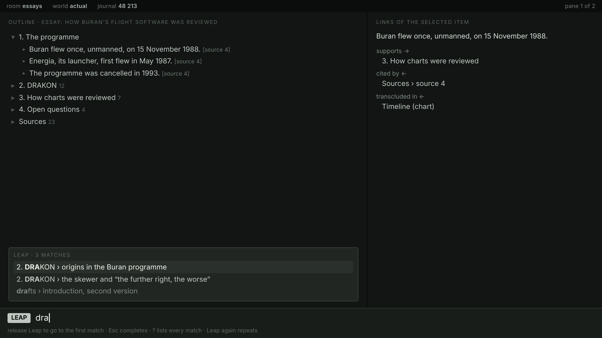
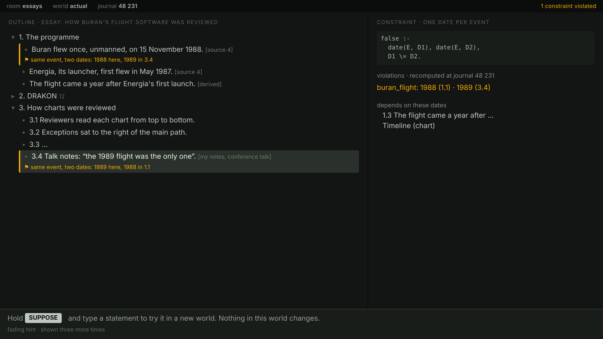
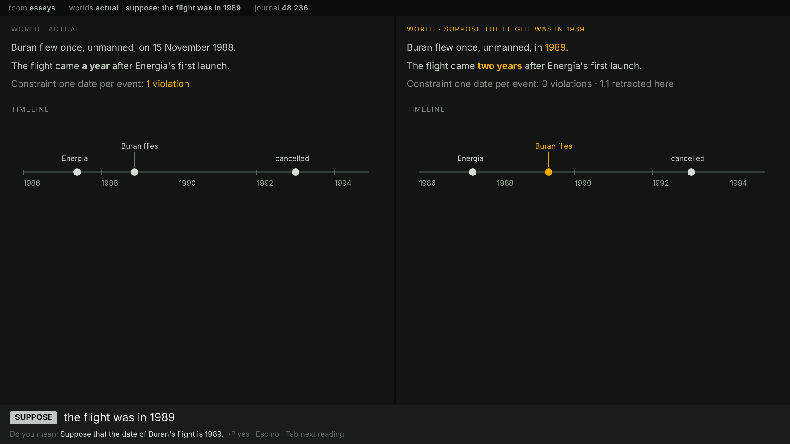
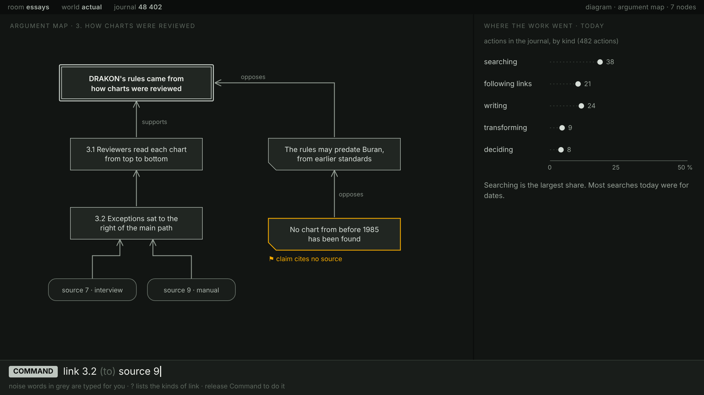

# Adversaria: working design

11 November 2026. Exported from the living Claude Doc of the design.

## Purpose

The project is named **Adversaria**, after the notebooks in which scholars kept their observations, excerpts and drafts. A web search found no clashing software (a search cannot prove absence; no trademark registry was searched). Its prototype moves to a repository of its own; this document still calls the system “the memex” where it describes its design.

The memex is a cognitive augment for its one user, in the sense of Bush's memex (1945) and Engelbart's NLS (1968). It holds the user's own material, links it, finds it fast and shows it many ways. Reasoning over it in English comes later, through the translator in [Complex Koopman Reservoir: a local English–Prolog translator](https://claude.ai/artifact/K7iZLMRqHUyunZdX6wSyLS).

This is a working document, kept alongside the design conversation. Figures are estimates unless marked as measured; history is recalled from memory unless a source is linked.

The design does not depend on a platform. Its prototype runs on a PC: a terminal program written in Rust, SWI-Prolog as its reasoning engine in a child process, split at the query protocol, and a separate sealer process that dates and signs journal entries (see The PC prototype). Hardware that might run the memex is out of scope here.

## A user story

A morning's work on an essay about how Buran's flight software was reviewed. The screens are mock-ups, not software. The flight dates are real; the talk notes, sources 7 and 9, and the counts of actions are invented for the story.

### 1. Finding your place: Leap

You hold Leap and type “dra”. Three matches appear as you type, with the guide line beneath. You release Leap and land on the DRAKON section; nothing was opened, saved or chosen from a menu. The right pane shows the selected item's links: what it supports, what cites it, and where it is transcluded.

### 2. The memex notices a conflict: a constraint

You record a claim from a conference talk, attributed to its speaker: “the 1989 flight was the only one”. It is a claim, not a belief of yours, so the memex reports a disagreement between sources, not a broken fact: your source says 1988, the talk says 1989, and both items get a highlighted mark naming the other. The right pane shows the rule, a Prolog denial, the disagreement, and what depends on the date. A fading hint suggests trying the other date with Suppose.

### 3. Trying the other date: Suppose, and “do you mean?”

You hold Suppose and type “the flight was in 1989”. The translator restates it in controlled English, “Suppose that the date of Buran's flight is 1989”, and you press Enter. A second world opens beside the actual one, joined line by line. In it, the derived sentence changes from “a year” to “two years” after Energia's first launch, the timeline's point moves, and the constraint has no violation, because your source's date is retracted there. Your actual world is untouched. You decide the talk notes were wrong, and close the supposition.

### 4. Building the argument: a diagram, Command, and where the work went

You switch the section to an argument map. The thesis and its supports run straight down one vertical; objections sit to the right in a notched shape, and sources are rounded. One objection is highlighted: it cites no source. You hold Command and type “link 3.2 source 9”; the noise word “(to)” fills itself in, and on release the edge appears without moving a pinned node. On the right, the journal's count of today's 482 actions shows searching as the largest share, mostly for dates: Licklider's point, measured on your own work.

## Glossary

| Term | Meaning |
| --- | --- |
| Journal | the append-only record of every change; described below |
| Sealer | a separate process that dates and signs each journal entry, and alone holds the private key; described under The journal |
| World | a branch of the journal's undo tree, after VPRI's Worlds: it reads through to its parent and keeps its own changes, so suppositions, undone work and versions do not disturb the original; Suppose names one |
| Quasimode | a state kept only while a key is held, after Raskin; described under The outline model |
| Controlled English | a subset of English with one meaning per sentence; here ACE |
| ACE | Attempto Controlled English, a controlled English that its parser turns into logic |
| APE | the Attempto Parsing Engine: parses ACE and restates a parse in ACE |
| s(CASP) | a Prolog-based reasoner used here for counterfactual questions |
| Predictive editor | an editor that offers only the words the grammar accepts next |
| Mechanism IDs | N (NLS/Augment), X (Xanadu), J (notebooks), L (live simulation); listed under Mechanisms considered |

## Features

The core is a store of items with permanent addresses, typed links and named trails through them, fast search, views, and an append-only journal of every change. NLS had the addresses and the journal, and Bush's memex had the trails. Priorities 1–4 order the work.

| Feature | From | What it needs | Priority |
| --- | --- | --- | --- |
| Items with permanent addresses, down to a paragraph or statement | NLS: every statement had an address | addresses in the append-only journal, which never change (adopted: X3, N2) | 1 |
| An append-only journal of every change, which can be cited | NLS's Journal | each edit a committed world (Worlds); entries ordered by sequence number, and dated and signed by the sealer | 1 |
| Typed links from any item or span to any other | Bush's associative linking; NLS links | a plain link table (from, to, type), also held as Prolog facts (`supports(A, B)`, `cites(A, B)`), so Prolog can follow them | 1 |
| Search by words and by structure | NLS content filters | an inverted index over text and the link table, answering within the 0.1 s limit (L6); Prolog over links | 1 |
| Views: the same structure as outline, levels or filtered | NLS view specs | views as queries over the store, rendered without copying; content filters in Prolog | 2 |
| Several panes side by side | Bush's twin screens; NLS windows | two or more views at once, for comparing and linking | 2 |
| Named trails: ordered paths through items | Bush: trails named, recalled and copied for a colleague | a trail is a named list of links | 2 |
| Annotation: marginal notes attached to a span | Bush's marginal notes; NLS comments | anchors to character ranges that survive edits | 2 |
| Sharing trails | Bush | exported as a signed bundle (see Signed entries and exchanging journals) | 3 |
| Capture beyond typing | Bush: dictation and a camera | import of files and pages from the network; mail, calendars and web pages as well (see Mail, calendars and the web) | 3 |
| An interface for a trained user | Engelbart's chord keyset | keyboard commands and typed controlled English, with the predictive editor to teach it | 3 |
| Reasoning over the store | beyond Bush and Engelbart | items and links as facts, so "what if" and "do you mean?" work on the user's own knowledge | 4 |

## The journal

One append-only journal carries five adopted mechanisms at once: permanent span addresses (X3), every version kept with branches (X4), named statements (N2), who changed what (N8), and a log of computation (J4). Nothing in it is ever overwritten, so each follows from one rule.

1. Every change is an entry with a sequence number, its author, and its operation: text appended, structure changed, a name set, a link made, or a query run with its answer, unless the user has switched off the journalling of queries.
2. Text is appended once and never rewritten. The address of a span is its position in the journal, so it never changes and is never reused (X3).
3. A statement is a list of spans plus its place in the outline. An edit writes a new list as a new entry; the old one stays, so every version is kept. A branch is a world sprouted from any entry (X4).
4. A name is an entry mapping it to a statement, so links that use names survive restructuring (N2).
5. Each statement's latest entry names its author and sequence number, so "who changed this, and since which entry" is a query. The sealer dates each entry, and the memex reads the dates to show them (N8).
6. A query and its answer are journal entries, recording the world they ran in, so any result can be run again on the same state (J4).

Two more follow without extra mechanism. Annotation anchors on span addresses survive edits, because surviving characters keep their addresses. Transclusion (X1) becomes a list of spans that points into another statement's text; it is adopted under References.

The cost is growth: the journal is never shortened, so span lists need compacting, and a true deletion, for privacy or by law, is a purge: it removes an entry's content and keeps its hash, so the chain still checks (see The journal format).

The journal also measures the user's own work, as Licklider's 1957 study of himself did: he found about 85% of his "thinking" time went to getting into a position to think, by searching, plotting and transforming ("Man-Computer Symbiosis", 1960, §3.1). A view over the journal counts the user's actions by kind (searching, following links, transforming, writing, deciding), so the memex shows where the work goes and which clerical steps to remove next. It counts actions, not seconds: an entry's date says when it was sealed, not how long its work took.

As built (milestone 7): the memex records what reasoning shows as `view` entries, as rule 6 asks of a query and its answer: `observed` (the current world's violations and disagreements, when they change) and `offer` (suggestions shown in the pane for the first time). `crates/tools`' `measures` program reads only the journal. It counts:

* each entry as an action of one kind (writing, searching, following links, navigating, deciding, checking, importing, exporting), as an observation, or as unclassified;
* the clerical share: searching, following links and navigating;
* suggestions offered, adopted, dismissed, and adopted then retracted;
* violations seen, and those later gone in the actual world (corrected);
* disagreements seen.

`make measures JOURNAL=…` runs it.

Undo has two forms, after the literature on selective undo (Berlage 1994; Prakash and Knister 1994; Yoon and Myers 2015, where selective undo made programmers about twice as fast). Plain undo and redo move along the current branch, as everyone expects. To reverse one earlier decision, such as an adoption, the user **retracts** it instead of rewinding to it: a retraction is a new entry that reverses the old one and keeps everything done since, and before it is confirmed the dataflow graph lists what depended on it. Retracting is unadopting, generalised to any entry, so it adds no concept. Every adoption of a suggestion is an entry marked as one, with the suggestion's evidence, so an adoption made without checking can be found and retracted later, the user can see the path of their decisions, and, since entries are facts, a query searches them (“every suggestion I adopted this week”, “what did I decide about Buran's date”).

Undoing and then editing starts a new branch instead of discarding the old one, so undo and redo form a tree, as in Emacs and Vim; the journal stays append-only, and the tree is a view over it. A history pane shows the tree; it is described below. A world and a branch of the tree are one concept: each is an alternative state of the store chosen by a decision, and undoing is a decision too. Branches come only from Suppose and from undoing and then editing, and each is named by its first change, which the user may rename. A branch always keeps its own state, so moving between worlds asks nothing and loses nothing, as in Gitless (Perez De Rosso and Jackson 2013). The actual world is the branch the user works on; closing a supposition leaves its branch in the tree, to be found, compared and reopened; and worlds open side by side, where one edit can apply to all of them, after Parallel Paths and subjunctive interfaces (Terry and Mynatt 2004; Lunzer and Hornbæk 2008). Because retraction keeps most work on one branch, most users meet the tree only in the history pane.

The journal is a scientific record, so its entries are dated and chained. These are obligations, not preferences: research-integrity codes, funders and journals expect a record that is attributable, unaltered and dated, as a bound lab notebook's dated pages are.

1. **Hash-chained.** Each entry holds the SHA-256 hash of the entry it follows, so the journal is a chain of hashes along each branch and a tree of them across branches, as Git's commits are. Changing or removing any entry breaks every hash after it, which anyone can check from the journal alone.
2. **Dated by the sealer.** A separate process, the sealer, alone holds the private key and alone writes `seals.jsonl`. As each entry commits, the sealer stamps it with the date from the system clock, in a log of seals of its own whose records are hash-chained too, each binding an entry's hash to a date and to its author's signature. The memex never writes a seal and never holds a key, so it cannot date or sign an entry. It reads the dates, to show each one beside its entry and to answer questions by date (“what did I decide last week”).
3. **Anchored outside.** From time to time the hash at the head of each branch can be sent to an external timestamping service (RFC 3161), which proves that the record existed by that date without revealing its content.

### The journal format

The journal must outlive the memex, so its format is open, plain and documented, and readable with common tools. One format serves for storage and export; the query protocol's tagged cells are only how terms cross between the client and the server.

| Part | Specification |
| --- | --- |
| Files | each journal is a directory: `journal.jsonl`, written only by the memex; `seals.jsonl`, written only by the sealer; `keys.jsonl`, the public keys of the authors whose entries the journal holds; and `blobs/`, holding images, figures and imported files, each named by the SHA-256 of its content |
| Lines | JSON Lines: UTF-8 text, strings and object keys in Unicode NFC (the memex normalises text to NFC before it writes; a reader refuses a line with text not in NFC), one JSON object per line, never rewritten except by a purge, which replaces one entry's `body` with null. The first line of each file is a header: `{"format": "memex-journal", "version": 1}`, or `"memex-seals"` or `"memex-keys"` |
| An entry | `seq`, its sequence number, 1 for the first entry and one more on each line; `parent`, the `seq` of the entry it follows, null only for entry 1; `prev`, the hash of that entry, null exactly when `parent` is; `kind`, one of edit, link, adopt, retract, suppose, name, import, purge, undo, redo, view; `body`, a JSON object whose fields the kind defines, or null once purged; `body_hash`, the SHA-256 of the body's canonical JSON; `hash`, the entry's own hash |
| A term | a JSON integer, at most 2^53 − 1 in magnitude, for an integer; `{"float": text}` for a float; a JSON string for a Prolog string; `{"a": name}` for an atom; `{"v": n}` for a variable; `{"f": name, "args": [...]}` for a compound term. A float's text is canonical: ECMAScript's shortest form (as RFC 8785 writes numbers), with `.0` added when it would read as an integer, and `-0.0` for negative zero; NaN and infinities are refused. Floats are tagged because RFC 8785 writes 1.0 and 1 alike, and Prolog tells them apart. Format version 1 (decided 12 November 2026, before any journal was written) |
| Kinds that carry more | adopt carries the suggestion and its evidence (support, exceptions, violations); retract names the entry it reverses; import carries its provenance as W3C PROV-JSON and refers to its files in `blobs/` by hash |
| A seal record | `seq` and `entry_hash`, the sequence number and hash of the entry it seals (seal n seals entry n); `date` in ISO 8601 UTC to the second, as `2026-11-12T09:30:00Z`; `author`, the fingerprint of the author's key; `sig`, the author's Ed25519 signature (RFC 8032) over the 32 bytes of the entry's hash, in hexadecimal; `prev`, the hash of the previous seal record, null for the first; and its own `hash`. (Version 1 names the entry's hash `entry_hash`, since the record's own hash is `hash`.) |
| The hash | SHA-256, in lowercase hexadecimal, of the canonical JSON (RFC 8785) of the record without its `hash` field and, for an entry, without its `body`: the entry's `body_hash` stands for the body, so a purged body leaves every hash checkable. Fields a reader does not know are kept and covered by the hash. Every line is itself the canonical JSON of its record, so changing any byte of a line breaks its form or its hash |
| A key record | `alg`, `"ed25519"`; `key`, the 32-byte public key in hexadecimal; `fingerprint`, the SHA-256 of those 32 bytes; and its own `hash` |
| Facts | a body may carry `"facts": [term, ...]`, facts the entry adds; a retract entry's body is `{"target": seq}`, naming an earlier entry on the same branch whose facts it removes. A world's store is the facts of the entries on the path from its head back to the root, in order, less those retracted on that path; a purged entry's facts are gone. A retraction of a retraction is refused: adopt the facts again instead |
| The outline's bodies | edit `{"op":"init"}` is entry 1. edit `{"op":"create","under":p,"after":s,"add":text,"spans":[[seq,start,len],...]}` makes an item, known by its seq, under p (0 is the top) after sibling s, or first if s is null or gone; `{"op":"text","item":i,"add":text,"spans":[...]}` gives it new text; `{"op":"move",...}` and `{"op":"delete","item":i}`. Text is appended once in `add`; an item's text is the list of spans, and span seq 0 means the entry itself, so surviving characters keep their addresses and a span into another item's text is a transclusion. link `{"from":a,"to":b,"type":t,"facts":[t(a,b)]}`; name `{"name":n,"item":i}`; suppose `{"name":n}` |
| Undo, redo and view | undo `{"undoes":seq}` has as parent the entry before the one it undoes, so the state at any entry is the replay of its path; redo `{"redoes":seq}` has the redone entry as parent; an edit after an undo starts a branch. view records what is shown (panes, cursor, text position, folds, scope) in full, and in `op` the action: move, leap (with its pattern and what it found), follow, fold, pane, scope. Cursor moves and typing are merged into one entry until another kind of action, or a second without keys. Added to version 1 for milestone 3, before any journal was kept |
| A purge | first a purge entry, whose body is `{"reason": text, "target": seq}`, naming an earlier entry that is not a purge; then that entry's `body` becomes null. A body is null exactly when one purge entry names it |
| The private key | one line, the 32-byte Ed25519 secret in hexadecimal, in a file readable by its owner only (mode 600), which only the sealer reads |
| Checking | a reference checker, a small Rust program, is published with the format; it verifies both chains, every signature against `keys.jsonl`, and every blob's name, and needs nothing from the memex |

Text costs space: a JSON entry takes several times the bytes of its tagged cells (an estimate). The format's version number allows later kinds and fields; a reader ignores fields it does not know.

The history pane draws the undo tree by the rules for diagrams:

1. **The current branch is the main path.** It runs straight down one vertical, newest at the foot; branches left by undoing sit to its right, as DRAKON puts exceptions to the right.
2. **Entries are grouped.** A run of edits to one item becomes one node, named by the item, so the pane stays within the size limits for diagrams; a node opens on request to its entries.
3. **Kinds are told apart by shape.** An adoption of a suggestion, a supposition, an import and an ordinary edit each have their own shape, and an adoption shows the evidence it was offered with.
4. **A query filters it.** The pane can show only adoptions, only one item's history, or the result of any query over the journal; Leap moves through it like any other view.
5. **Pointing previews, choosing compares.** Pointing at a node previews the store as it stood there; choosing it opens that state in a second pane, side by side with the present, never animated between them. Choosing an earlier decision offers to retract it and keep all later work; moving the current state to the node instead is an ordinary undo or redo, itself a journal entry.

## Dataflow

The memex is a dataflow graph over the journal, in the spreadsheet model. This one mechanism replaces five candidates (L1–L5), so a reader holds one concept instead of five.

| Former candidate | Its place in the graph |
| --- | --- |
| L1 Recomputation by dependency | the engine: a change recomputes only its dependents |
| L2 Reactive documents, with executable content (J1, J2, J6) | an item holds prose, runnable Prolog queries (each a node, kept apart from the engine that runs it), their live results, and controls, so the reader changes assumptions in place. The notebook weakness of hidden state from cells run out of order cannot arise, because every node is a pure query over a committed world |
| L3 Ladder of abstraction | the graph evaluated over a range of one input, then one case selected |
| L4 Parameters as controls | source nodes that the user sets with a slider, menu or checkbox |
| L5 Named scenarios compared | one instance of the graph per named world, with a live comparison |

1. Nodes are items, parameters and queries. A query is pure Prolog over one world.
2. Edges are the facts and parameters a query read, recorded when it runs.
3. A new journal entry marks every direct and indirect dependent as dirty, and only those are recomputed, in dependency order. A cycle is an error.
4. A control is a source node in an item's text. Each value it takes is a world with one fact changed. While a control is dragged, those worlds are not journalled; the value at release is one journal entry.
5. A sweep evaluates the graph over a range of one parameter as sibling worlds; pointing at one result selects that world.
6. A scenario is a named world. A table comparing scenarios is a query across worlds, so it stays live; Excel's scenario reports, by contrast, are not recalculated.

It holds three properties by structure. Nodes are pure queries over committed worlds, so there is no hidden state. No node reads the clock or calls a volatile function: a query about dates, such as “last week”, takes the present date as a parameter that its journal entry records, so the same inputs always give the same values. Any value can be rebuilt from the journal, so caching values is an optimisation, not a source of truth.

SWI-Prolog's incremental tabling, recalled from memory and not checked, records which facts each tabled answer depends on and recomputes only what a change invalidates: the engine of rule 3 above, built in. s(CASP) is not tabled, so how its counterfactual queries join the graph is open.

Constraints are nodes too, so the memex turns up flaws without being asked, as Licklider wanted computers to do in trial-and-error thinking. A constraint is a Prolog denial over one world, such as two items that claim the same date for different events, or a claim that cites a retracted source. Its node's value is the list of violations, recomputed on every change like any other node, and each violation shows beside the items it names. The user need not write them all: the translator's model suggests constraints, facts and rules, each shown with the violations or exceptions it would raise, and each entering the journal only when accepted (see the translator document). The model runs all the time and keeps a pane of suggestions; one click adopts a suggestion and another unadopts it, each an ordinary journal entry under universal undo.

### Response time (adopted L6)

The graph must update within the limits that keep interaction direct (Nielsen, 1993, updated 2014, citing Miller 1968 and Card, Robertson and Mackinlay 1991):

| Interaction | Limit | Why | On a PC |
| --- | --- | --- | --- |
| Navigating and editing the outline, a Leap, following a link | 0.1 s | "the limit for having the user feel that the system is reacting instantaneously" | an index lookup and a redisplay (estimate) |
| Dragging a control, changing a view that runs a Prolog filter | 0.1 s | the limit for direct manipulation | SWI-Prolog: s(CASP) queries took 2–66 ms on small tests (measured), so only small models stay live |
| A query, a parse with its restatement, a "do you mean?" proposal | 1 s | keeps "the user's flow of thought" | a parse and its restatement in about 3.6 ms (measured); a model's proposal sets the time of a round |
| A long simulation or search | 10 s | keeps attention; beyond it, show progress and allow interruption | most work, with a progress indicator |

### Prolog timings

Every Prolog timing in either document comes from this table.

| Operation | Measured on a 4-core Xeon (SWI-Prolog) |
| --- | --- |
| APE parse of one sentence | about 2.5 ms (tokenise 0.96, parse 1.52, anaphora 0.03) |
| APE restatement | about 1.1 ms |
| Parse and restatement together | about 3.6 ms |
| s(CASP) counterfactual or simulation query (small tests) | 2–66 ms |

Sources: [Response Times: The 3 Important Limits](https://www.nngroup.com/articles/response-times-3-important-limits/), [Observable runtime](https://github.com/observablehq/runtime), [Explorable Explanations](http://worrydream.com/ExplorableExplanations/), [Up and Down the Ladder of Abstraction](http://worrydream.com/LadderOfAbstraction/), [Manipulate](https://reference.wolfram.com/language/ref/Manipulate.html), [Excel recalculation](https://learn.microsoft.com/en-us/office/client-developer/excel/excel-recalculation), [Introduction to What-If Analysis](https://support.microsoft.com/en-us/office/introduction-to-what-if-analysis-22bffa5f-e891-4acc-bf7a-e4645c446fb4).

## Views, references and anchors

Four adopted mechanisms: three merge candidates that did the same job in different systems, and workspaces (J5) stands alone. All three rest on the journal's permanent addresses, and every view is a dataflow node, so it stays live.

| Mechanism | Merged from | How it works here |
| --- | --- | --- |
| Views | N5 view specs, N6 freezing, J3 synchronised views, X5 side-by-side versions | A view is a query over the store: an outline level, a truncation, and a content filter written in Prolog. Views open in panes, and a pane can be frozen in place. Two panes can show versions or worlds side by side, with lines joining spans that share journal addresses. |
| References | X1 transclusion, J6 code blocks called as functions, J3 mirrored output | Content is defined once and used elsewhere by reference: a span (transclusion), a query called with arguments, or a result shown in another place. A reference is resolved through permanent addresses and shows its origin, so the same content appears "knowably" in more than one place. |
| Anchors | N3 markers, X2 links that cannot break | A named point or span is anchored on journal addresses. Links attach to anchors, can be followed from either end, and stay attached through edits; only deleted characters drop out. |
| Workspaces | J5 saved workspaces | The open panes, their views and their layout form an item in the journal, kept as the user works with no Save. A workspace is restored or switched by name, and any earlier state of it can be reopened from the journal. |

NLS reported that a skilled user changes view settings "several times in as many seconds", so views must meet the 0.1 s limit (L6). Xanadu never shipped as a product, and Nelson's paper "Xanalogical structure" (2000, listed in the sources) admits "difficulty delivering product": only the parts that the append-only journal makes cheap are adopted.

## A/B comparison

Science compares: two states that differ in one thing, seen under the same questions. Worlds give the states; the interface makes comparing them direct. Gleicher et al. found that every design for visual comparison is built from three parts: juxtaposition, superposition and explicit encoding of the differences (“Visual comparison for information visualization”, 2011). The mechanisms below are proposed.

1. **A comparison is an item.** It names its worlds (A and B, or more) and the views to compare. Like any item it is kept in the journal, linked and searched, so a comparison made last month reopens as it was.
2. **One variable at a time.** The comparison states what differs between its worlds, computed from their own changes (“A and B differ in: the date of Buran's flight”), and marks it in a highlight colour when more than one thing differs.
3. **Juxtapose.** Each world in its own pane, side by side, rows aligned by item and joined by lines where they correspond. Charts in every pane share one scale, since position on a common scale is judged best (Cleveland and McGill).
4. **Superpose.** For two worlds, one chart or diagram holds both: A in the ordinary colours and B in a highlight colour.
5. **Encode the difference.** A table of only what differs: facts added and removed, derived values with their change, constraint violations gained and lost.
6. **Linked panes.** Scrolling, selecting and Leap move every pane together. An edit applies to all the worlds unless it is the variable under test, after subjunctive interfaces (Lunzer and Hornbæk 2008).
7. **More than two.** A supposition over a range (“suppose the date is 1987 to 1990”) makes a family of worlds, shown as small multiples on one scale; up to about four panes side by side, the span of working memory, and more as small multiples.
8. **A result can become a claim.** The outcome of a comparison can be adopted as an item, citing the comparison as its evidence.

## Claims and beliefs

Nothing that comes from outside is trusted as a fact. An imported document, a web page, a mail, a collaborator's entry, a Wikidata statement, an analysis's result and a model's suggestion all enter as claims: `claims(Source, P)`, the source with its provenance, never `P` itself. The user's own beliefs are what the user has written or adopted. This answers the reviewers' point that knowledge workers deal mostly in who claimed what.

1. **Constraints run on beliefs.** A constraint broken by the user's beliefs is a violation. A constraint broken among claims, or between a claim and a belief, is a disagreement between sources, shown apart and less loudly: it is information, not an error.
2. **Adopting is one click.** Adopting a claim writes an adopt entry that names the claim and its source, so the belief keeps its evidence; retracting is one click too. A suggestion is a claim whose source is the model, so suggestions and claims share one mechanism.
3. **Interrogating is one key.** On any claim, a single key opens questions answered at once from the store: who else claims it, and who claims the contrary; what follows if it is adopted, previewed as a world; where it came from, with its provenance; how this source's earlier claims fared, adopted or retracted; and what the model can find to support or oppose it, among works already in the store.
4. **Sources build a record.** Each adoption or retraction of a source's claim is a fact about that source, so how reliable a source has been is a query, not an impression.

### As built (milestone 4)

* **Facts on items.** An item states facts (`fact date(buran_flight, 1988)`), or a source's claims (`claim date(buran_flight, 1989) from my notes, conference talk`), stored as `claims(Source, P)`. Adopting (F3) writes an `adopt` entry naming the claim, its item and its source, with P as a belief; F4 retracts the last adoption. Interrogating (F2) answers the five questions above from the store, with the preview of adoption computed in a spare engine.
* **Constraints and derived items are dataflow nodes**, defined by `node_def` facts in the journal and computed by an incrementally tabled `node/2` in `prolog/dataflow.pl`. A constraint's body is matched against beliefs and claims together: a solution resting on beliefs alone is a violation (shown loudly), one resting on a claim a disagreement between sources (shown dimmed). The tables must be shared: the server runs each query in its own engine, and private tables were rebuilt for every query.
* **Dependencies are per call variant**, as milestone 0's spike found: a node is recomputed only when a changed fact unifies with a call it made. A sentence that reads the dates of two named events is not recomputed when a third event gets a date.
* **The planted violation**: before a constraint is kept, its variables are given distinct integers, in every order until its built-ins hold, the other literals are planted as facts, and the constraint is run over them. A constraint that cannot fire is refused.
* **Suppose without APE**: the readings are the world's own facts with one number changed to a number in the text, ranked by how many words name the fact's other arguments, and restated through a generic frame and `label` facts ("the date of Buran's flight is 1989"); Tab gives the next reading. Then revision: each belief that breaks a constraint together with the supposition is retracted in the supposed world only (the supposition is the more entrenched).
* **Worlds**: a supposition shows the actual world and the supposed one side by side, row for row; `close` returns to the actual world by a `view` entry whose parent is the actual head, keeping the branch; `commit` makes the supposed world actual.
* **The fading hint** to try Suppose on a marked item stops once Suppose has been used four times.

### Testing claims

A claim is tested by the cheapest check that could refute it. These checks come from the author's “Popper” project, which routes each claim of a physics paper to such a judge; it has 105 passing tests but no measured rate of catching errors yet. The mechanisms below are proposed.

| Check | How | Rulings |
| --- | --- | --- |
| **The quote** | every imported claim keeps the verbatim span it came from and the hash of the source; the check ignores spaces, hyphens and case | quoted, or misquoted when the span is not in the source |
| **The source** | the memex fetches the source itself by its identifier (a DOI through Crossref, or an address), never trusting a copy that came with the claim, and records the hash of what it read | quoted, misattributed, not found, unavailable, or retracted |
| **The provenance** | a claim counts as evidence for a belief only if its source rules quoted; a source's support for its own claims, such as a paper's own data, counts as weak | gated, with the reason shown |
| **The weakest link** | every premise of a derived belief names its origin: a source, a constant, or an assumption with its reason. The belief takes the weakest ruling of its premises and lists every assumption it rests on | the weakest ruling, with the assumptions |
| **What is left open** | a relation that depends on a parameter the source does not state is tested over that parameter's range, as a family of worlds | holds, fails, or underdetermined, with the range over which each holds |
| **Independence** | corroboration counts only from sources independent by provenance: not the same author, data or upstream source | independent, or not |
| **Gaps shown** | each kind of claim routes to the checks that can test it; a kind that no check covers, such as an interpretation, shows as unchecked, never as passed | unchecked |
| **The checks themselves** | every constraint the user adopts is tried against a planted violation, to show that it fires | fires, or broken |

The rulings are facts about claims, so they are queried, shown and compared like any others, and each records the hash of what it examined. Uncertain values follow the Uncertainty section, which keeps a bound and a standard deviation apart as Popper's judges do.

As built (milestone 6), two checks of the table above:

* **The quote check** (`check quote`): an imported item's text, as plain text, must appear in the plain text of the document it came from, ignoring spaces, hyphens and case. It rules `quoted` or `misquoted`.
* **The source check** (`check source`): the DOI an item states (`doi(E, "10.…")`) is fetched from Crossref by the memex itself. It rules:
  * `not_found` for a 404;
  * `unavailable` when nothing usable came back;
  * `retracted` when Crossref lists a retraction in `updated-by`;
  * `misattributed` when the item states a title (`title(E, "…")`) that differs, beyond spaces, hyphens and case;
  * else `found`.

Each ruling is a fact `ruling(Item, Check, Ruling, Hash)`, with the hash of what was examined.

### Falsifiability of formal claims

A claim written in Prolog, by hand or through APE, can be measured for how it could be refuted, after Popper's *Logic of Scientific Discovery*. This section is written for an implementer. The measures are proposed; none is built or measured.

**Notation.** H is the program of the user's beliefs: rules, facts and constraints (denials, `false :- ...`). C is the claim, a goal. An observation is a ground atom of an observable predicate. O is a finite set of observations, and k is its size.

**1. Declare the observation vocabulary first.** Prolog's closed world makes every unproved atom false, so without open predicates every claim looks decided. Each predicate is therefore declared, as an adopted fact, to be one of:

- *observable*: the world supplies its facts, as `observable(p/2)`;
- *theoretical*: open, but not observed directly, as `theoretical(q/1)`;
- *closed*: defined by H alone.

Each argument of an open predicate has a domain: a finite list of values, an integer range, or the reals, as `domain(p/2, 1, colour)` with `colour` enumerated. The declarations are claims about the world in their own right, and the rulings below hold only relative to them. A tool generates one `#abducible` line of s(CASP) for each open predicate.

**2. Restrict to one model where possible.** A program without negation through a cycle (a *stratified* program) has one model, so “C fails” means the same in every model. The measures below assume H is stratified, which a static check of the predicate dependency graph establishes. For an unstratified H, s(CASP) finds a model in which C fails, not that C fails in all, and the ruling must say “in some model”.

**3. The measures.**

| Measure | Definition | Procedure | Result |
| --- | --- | --- | --- |
| Compatible | some O consistent with H lets C hold | query `?- C.` with open predicates abducible | compatible, incompatible, or unknown within the budget |
| Independent | some O over the open predicates, observable or theoretical, consistent with H, makes C fail | query `?- not C.` with all open predicates abducible; s(CASP) returns the abduced atoms in its justification. Confirm by adding them as facts, turning abduction off, and checking that `?- C.` fails | independent, or entailed by H (the claim restates its premises) |
| Refutable | the same, with O over observable predicates only | as above, with only observable predicates abducible | refutable, or not empirical relative to the vocabulary (only theoretical facts could refute it) |
| Characteristic number k | the size of the smallest refuting O; Popper's dimension is k − 1 | iterative deepening on n = 1, 2, …: enumerate sets of n observations, only over atoms that C depends on through the dependency graph; for each, add it to H, reject it if a denial fires, and test that C fails, with SWI-Prolog's tabling for speed. Stop at the first falsifier or at the budget | k = n with its falsifier; or k > n, exhausted, for finite domains; or unknown above n |
| Numeric dimension | for a law with real parameters, the number p of parameters a fit can adjust; then k = p + 1 | outside Prolog, in the analysis tools: sample points, and take the numerical rank of the law's Jacobian with respect to its parameters | p and k, marked as a numerical estimate |
| Needed premises | each premise h of H that C's justification uses matters | for each such h: recompute compatibility and k with H without h | needed, or idle |
| Comparative strength | claim A is at least as falsifiable as B when every falsifier of B also refutes A, which holds when A entails B under H | query `?- A, not B.` with abduction; no model means A entails B | stronger, weaker, equivalent, or incomparable |
| Immunisation | adopting hypothesis h rescues claim C from a falsifier found before | every falsifier found is kept as a fact; when h is adopted, re-test C against the stored falsifiers under H with h | the falsifiers that h defeats, shown beside the adoption |

**4. Records.** Each result is a fact, `falsifiability(Claim, Measure, Result, Bound, Budget, Engine)`, citing the hash of the part of H it used, so the dataflow graph recomputes it when that part changes. A falsifier opens as a world, “suppose these observations”, in which the user sees the claim fail. Searches run in the background with a budget, outside the 0.1 s limit; a result arrives when it is ready, and a bound is always shown as a bound.

**5. Engine notes.** Run s(CASP) with `--forall=sasp` until its issue #13 is fixed. Use SWI-Prolog with tabling for the enumerations of stratified programs; reserve s(CASP) for abduction and for unstratified programs. The general problem is undecidable, since Prolog is Turing-complete, so every procedure is bounded by its domain and its budget.

**6. Tests to build first.** Each has a known answer and a planted fault.

1. A claim that restates a fact of H is ruled entailed, not independent.
2. “All swans are white”, with `swan/1` and `black/1` observable over a domain of three birds, has k = 2: one bird that is a swan and black. Making `black/1` closed and empty makes the claim not refutable.
3. A claim that mentions only theoretical predicates is independent but not refutable.
4. A premise that the claim's justification never uses is ruled idle.
5. A straight line through points with small integer coordinates has k = 3; adding a third parameter makes k = 4.
6. After the black swan is observed, adopting “black birds are not swans” is flagged as defeating that falsifier.
7. Each test is also run with its procedure broken on purpose, as Popper's judges are, to show that the test fails.

## Importing results

The memex is not a tool for analysing data; Python, R and Julia are. It takes their results in as facts that carry their provenance, so a claim built on a number can be traced to the data and the code that made it. The mechanisms below are proposed.

1. **One exchange file per run.** The analysis writes its results as rows (CSV or JSON) and a provenance record in the W3C PROV model: the script and its version-control commit, the command, the tool and library versions, and a content hash of each input file. A small helper library in each language writes it, so the analysis changes by one call.
2. **An import is a journal entry.** It adds the results as facts, each citing the import; the history pane shows it in the shape for imports. A figure comes in as an image, shown beside the facts it plots.
3. **Values carry units.** A result declares its unit, and constraints check units and ranges as they check anything else: a probability above 1, or a length added to a time, is a violation.
4. **Re-running is comparing.** Importing a new run of the same analysis starts a world beside the old one, so the A/B comparison shows which results changed and which claims depend on them; adopting the new run is a decision like any other, and retracting it restores the old.
5. **Reproducible by construction.** The provenance record holds what is needed to run the analysis again; the memex marks a result whose inputs no longer match their hashes.

The helper writes the file where the memex reads it.

As built (milestone 6): `helpers/python/memex_results.py` writes the exchange file (`format: memex-results`). It holds results as name, value, standard uncertainty and unit, and provenance as W3C PROV terms: the script, its commit, the command, the Python version, and the SHA-256 of each input file. `import results` makes an item for the run and one per result, each stating `claims("script@commit", result(Name, measured(Value, Uncertainty, Unit)))`. A result whose input file no longer matches its recorded hash is marked "input changed since".

## Uncertainty

A measured value without its uncertainty is half a fact. The memex holds four kinds of not-knowing, and keeps them apart, because each is a different question: how far off a number may be, how likely each alternative is, which alternatives exist, and how far a vague word applies. The mechanisms below are proposed; they follow the Guide to the Expression of Uncertainty in Measurement (GUM, JCGM 100:2008) and its supplement on Monte Carlo (JCGM 101:2008), the standards that metrology uses.

| Kind | Held as | Propagated by | Answers |
| --- | --- | --- | --- |
| A bound | `interval(Low, High, Unit)` | interval arithmetic, relational as in CLP(BNR), which SWI-Prolog offers as a pack (recalled) | guaranteed bounds; wide, because intervals forget that two inputs are the same quantity |
| A measurement | `measured(Value, StandardUncertainty, Unit)`, with degrees of freedom and covariances where known | the GUM's first-order law of propagation, when the model is nearly linear | a value and its standard uncertainty, as journals expect |
| A distribution | `distribution(Kind, Parameters, Unit)`, or samples in a blob | Monte Carlo, after the GUM's supplement: a fixed number of samples from a seed kept in the journal, so a run repeats exactly | intervals and probabilities for models far from linear |
| Competing alternatives | worlds, each with a weight | weighted worlds, as probabilistic logic programming weighs facts (ProbLog; recalled) | the probability of a claim across alternatives |
| A vague term | a membership function for a predicate such as “early” or “large” | fuzzy logic: degrees of truth combined by its connectives | how far a vague claim holds; never read as a probability |

1. **One rule chooses the method.** Bounds alone give interval arithmetic; measurements through a nearly linear model give the GUM's law; anything else numerical gives Monte Carlo; discrete alternatives give weighted worlds; vague terms give fuzzy degrees. The choice is shown with each result, so the reader knows what an interval means.
2. **Correlation is kept.** Inputs that share a cause carry their covariance, or come from one sampled source, since ignoring correlation is the commonest error in propagating uncertainty.
3. **Constraints become three-valued.** A constraint over uncertain values is satisfied for every value, violated for every value, or possibly violated, the last with its probability where one is known. A possible violation shows in outline, a certain one filled, both in a highlight colour.
4. **Charts show it.** Error bars and intervals on a common scale; a distribution as a small density curve; in an A/B comparison, the overlap of two worlds' distributions.
5. **Imports carry it.** Results from Python, R or Julia bring their uncertainties and covariances, or their samples as a blob.

Large Monte Carlo runs belong in the analysis tools, whose samples are then imported; the memex runs small models only.

## Sources and references

Reference management needs no tool of its own: a source is an item, and what is known of it is facts. Wikidata already describes tens of millions of scholarly works (its WikiCite effort; recalled, not counted), with properties that serve as the schema. The property numbers below were checked against Wikidata's own labels on 12 November 2026.

| Need | Facts |
| --- | --- |
| What the source is | Wikidata's own: DOI (P356), author (P50), title, published in (P1433), publication date (P577) |
| What cites what | cites work (P2860), between sources; `cites(Item, Source)` from the user's items |
| Whether it still stands | is retracted by (P5824), and the retraction data that Crossref took over from Retraction Watch and opened (2023, recalled) |
| The file | a PDF in `blobs/`, named by its hash, linked from the source's item |

This makes questions about sources ordinary queries: which claims rest on a single source; which cite a retracted work; which sources of a section cite each other. The constraint “a claim cites a retracted source” is the one the user story already shows. Sources the knowledge base lacks come in by DOI from Wikidata or Crossref over the network, or from a library in BibTeX or CSL-JSON, each as an import with provenance. For a paper, the memex writes CSL-JSON, which Pandoc and the common reference managers read. The translator's model also suggests references for a claim in its pane of suggestions, choosing only among works already in the store, so it cannot invent one; each suggestion shows why it was offered (see the translator document). The Wikidata subsets may leave out scholarly works to save space; which subset keeps them is an open question.

### As built (milestone 5)

* **The subset** is made by `crates/tools`' `wikidata` program, from the query service: each item's truthy statements without external identifiers, English labels, and its properties' constraints from P2302, as Prolog facts `wd/3`, `wd_label/2`, `wd_constraint/2`. `import wikidata <file>` copies the file into `blobs/` under its hash and writes an `import` entry with its provenance (derived from Wikidata, CC0, made by the tool). The memex loads it into each world whose path holds the entry.
* **Wikidata's statements are claims.** A user predicate is read against Wikidata through two adopted facts: `same_as(Entity, Q)` and `wd_property(Predicate, P)`. Then `P(E, Y)` is Wikidata's claim when Q's property P has value Y (for a date, its year). Constraints see these claims like any other, so a disagreement names "Wikidata" as its source.
* **Suggestions without a model**, from `prolog/dataflow.pl`:
  * entity links, from the label index: the whole name, or one word of it, ranked by Wikidata's dates near the user's;
  * property mappings, where a linked entity's Wikidata date sits beside the user's;
  * Wikidata's single-value constraints, for mapped properties, tried against a planted violation before they are kept;
  * rules mined from the beliefs, `Q(X, Y) :- P(X, Y)`, with support of at least 2 and confidence of at least 0.8, shown with their exceptions; an adopted rule is a `rule_def` fact the reasoner uses;
  * references, chosen only among works in the store (entities linked to a scholarly article), by main subject (P921) and citations (P2860) among stored works.
* **The pane's rules**:
  * it never takes the keyboard: `accept N` and `dismiss N`;
  * it shows at most five, ranked by score;
  * while it has focus, suggestions that remain keep their order and new ones go last;
  * a dismissal is a journal entry, and the suggestion returns only if its evidence changes.
* **Found on Wikidata**: P606 (first flight) has no single-value constraint; P619 (UTC date of spacecraft launch) has one. No scholarly article in Wikidata has the Buran spaceplane or programme as its main subject.

## Documents in and out

A scientist's work arrives as documents and leaves as documents: drafts from co-authors in Word or LaTeX, papers as PDF, and manuscripts, reports and theses to journals and examiners. Import and export are therefore a primary feature, not an accessory. The mechanisms below are proposed.

1. **One boundary format.** Every document crosses into the memex as Pandoc's document tree in JSON, and leaves the same way. Pandoc converts between that tree and Markdown, LaTeX, Word, OpenDocument, HTML, EPUB and JATS, the XML that journals use. The memex reads and writes only the tree, and runs Pandoc itself to convert it.
2. **A document maps onto the outline.** Headings become outline levels; paragraphs, lists and block quotes become items; citations become `cites` facts against sources; mathematics stays as LaTeX in its own items; figures and attached files go to `blobs/`; tables become items holding rows. Comments become annotations anchored to their spans.
3. **Re-import is comparison.** When a co-author returns a revised draft, importing it starts a world beside the current one. The A/B comparison shows each change, and the user adopts or retracts them one by one; tracked changes in a Word file arrive as suggestions in the pane. This is a merge that leaves a record: who changed what, and what the user decided.
4. **Export is a view.** A section of the outline, in one world, is exported as a manuscript: Markdown or LaTeX through Pandoc, with citations written as CSL-JSON and formatted to the journal's style. An exported document records the hashes of the entries it was made from, so a published text traces back to the record.
5. **Scholarly PDF is the hard case.** A PDF holds layout, not structure. GROBID, which extracts the structure of scholarly papers (title, sections, references) as TEI XML, converts it as a separate service; the result is imported with its provenance, and references are matched to works by DOI. Imperfect extraction is expected, so the import is a world to be checked before adoption.
6. **Read-only pages for colleagues.** A trail, an argument map or a section exports as plain HTML, with the hashes of its entries, for readers who do not run the memex; they can read it, and check it against a shared bundle, but not change it.

Round trips lose what the outline does not hold: page layout, fonts, and a journal's template. These belong to the export's style, not to the record.

### As built (milestone 6)

* **The mapping**:
  * a heading is an item at its level;
  * a paragraph, list item, block quote, code block, display formula (kept as LaTeX) or table is an item with that style;
  * a table's body rows are items under it, their cells joined by " | ";
  * an item's text is Markdown for its inline content, so emphasis, links, inline mathematics and citations survive;
  * a citation `[@key]` is also a `cites(Item, key)` fact. Keys are read from the text too, so citations survive Word, which carries them as text.
* **Losses are counted, not hidden**: each kind the outline does not hold (footnote, image, figure, raw block, definition list, and an identifier or attribute Pandoc would not make again) is counted, reported on import, and kept in the import entry.
* **Export** writes Markdown from the outline and runs Pandoc for the format asked. The document's metadata lists `source-entries`, the hashes of the entries its text came from.
* **Re-import** of a file already imported aligns its blocks with the items of the earlier imports (longest common subsequence on style and text). It writes the changes in a supposed world, one entry each: changed text, added items, deleted items. The world shows the table of changes; `retract N` drops one, and `commit` makes the rest real.
* In the format: a create body may carry `style` and `import` (the import entry that made the item). An `import` body names its `blob`, `format` (`document`, `memex-results`, `wikidata-subset`), source, provenance, and for a document its `losses`.

## Mail, calendars and the web

Most of a knowledge worker's week passes in mail, meetings and the web, so these come in through the same import path as documents, each as claims with provenance. The mechanisms below are proposed.

1. **Mail** from mbox or `.eml` files: each message an item, its sender the source, its thread a trail, its attachments blobs.
2. **Calendars** from iCalendar (`.ics`) files: each event an item with its people and its date; a deadline is a fact.
3. **Web pages**, clipped as their text and an image of the page, with the address and the hash of what was fetched.
4. **Due dates are shown by the memex.** It compares each deadline with the present date, read from the system clock for this pane only, and lists what is due and overdue in a pane of its own; choosing an item there moves to it. No dataflow node reads the clock (see Dataflow).

The memex does not send mail or keep a calendar: it imports them to be thought about, and leaves sending and scheduling to the tools that do them.

## Signed entries and exchanging journals

Collaborators can share the record itself, not only documents made from it. Real-time co-editing stays out: each journal has one user, and all sharing goes through export and import. The mechanisms below are proposed.

1. **Every entry is signed.** The sealer holds each user's private key, in a file that only it reads, and, as it seals an entry, signs the entry's hash with Ed25519 (RFC 8032) beside the date. The memex never holds a key, so it cannot sign for anyone. A signature says who wrote an entry; the hash chain says it is unaltered; the date says when.
2. **An entry is known by its hash.** Sequence numbers are local to a journal; across journals an entry is named by its hash, as Git names commits, so the same entry held by two people is recognised as one.
3. **A bundle carries a branch.** Exporting for a collaborator writes a bundle: the entries of chosen branches or sections, their seal records, the public keys of their authors, and the blobs they refer to. Sensitive blobs are left out, or sent encrypted to the recipient's key.
4. **Import checks, then offers a world.** On import the memex verifies every hash, chain and signature, and refuses a bundle that fails. A verified bundle arrives as a world, rooted where it shares history with the user's journal, or as a separate root where it does not. The A/B comparison shows what the collaborator changed.
5. **Adoption keeps authorship.** Adopting a collaborator's entry writes an adopt entry in the user's journal that names the original by its hash and author, so the record always shows who wrote what and who accepted it. Retracting works as for any adoption.
6. **Trust is a fact.** The keys the user trusts, and for what, are facts in the journal; a constraint flags entries signed by an unknown key.

A bundle travels as a file, by any means. Bundles answer asynchronous collaboration; editing together in real time is left out on purpose, since each journal has one user.

## Diagrams

The memex supports diagrams first-rate, with the keyboard and mouse and no pen: pens are awkward for language, and most input here is language. Studies of diagramming by pen and by mouse conflict (Apte and Kimura 1993; Forsberg et al. 2008), so a diagram earns its quality from structure and layout, not from freehand drawing.

1. **A diagram is a view.** Its nodes are items and its edges are links, held as facts, so one structure shows as an outline or as a diagram, and queries, constraints and the dataflow graph see it unchanged. There is no separate drawing format.
2. **The memex lays it out.** Layered layout for directed graphs, trees for hierarchies, and charts for data. The user pins a node by dragging it with the mouse; the pin is a fact in the journal, and layout keeps every pinned node (see Requirements and mechanisms below).
3. **Editing is ordinary editing.** A new node is a new item, typed; a new edge is a link, made with the Command quasimode and recognition on Escape. Each edit is a journal entry, so undo, versions and side-by-side comparison of two versions apply to diagrams as to text.
4. **Diagrams are live.** A diagram over a query redraws when the facts change, and each constraint's violations show on the nodes they name.

### Requirements and mechanisms

The requirements come from the literature on diagrams; the mechanisms are proposed. The evidence column says how firmly each requirement stands.

| Requirement | Source | Evidence | Proposed mechanism |
| --- | --- | --- | --- |
| Minimise edge crossings; they matter far more than bends or symmetry | Purchase 1997 | strong; symmetry inconclusive | layout's first objective is fewest crossings (layered layout with median ordering of each layer), then straight paths, then bends; symmetry is not an objective |
| Keep paths continuous and straight, and nodes on them few-branched | Ware, Purchase, Colpoys and McGill 2002 | measured; weights not confirmed | long edges run straight through their layers; the path the user follows (a trail, or the main path of a flowchart) lies on one vertical line |
| Put related things together, so the reader need not search | Larkin and Simon 1987 | foundational theory | every label sits on or beside its node, with no legend; an item's annotations and constraint violations show beside it; lines join a node to its item in an outline pane |
| One symbol for each concept, easy to tell apart, suggestive of its meaning, few in number, with text beside the graphics | Moody 2009 | design theory; four of its nine principles confirmed, five from memory | a fixed set of node shapes and line styles, one for each kind of item or link, told apart by shape and line style rather than colour; every symbol carries a text label |
| Manage complexity by splitting into linked diagrams | Moody 2009; DRAKON's silhouette | design theory and practice | a diagram over a size limit splits along the outline hierarchy into linked sub-diagrams, joined by Leap, at the size limits below |
| Fit the notation to the task | Moody 2009 (cognitive fit) | design theory | five diagram kinds, each with its own layout: flowchart, argument map (supports and opposes), tree, chart, and adjacency matrix |
| Charts: position on a common scale is judged most accurately, then length, angle and area, with colour last | Cleveland and McGill 1984; replicated by Heer and Bostock | strong | dot and bar charts on a common baseline; no pie charts; no quantity encoded in colour or brightness |
| Flowcharts: vertical flow, right angles only, no crossings, the main path straight down, exceptions to the right, branches ordered left to right | DRAKON | practitioner rules, untested alone; agrees with Purchase on crossings | the flowchart kind follows DRAKON's rules: main path on one vertical, worse outcomes further right, right-angle routing |
| Avoid meaning carried by layout alone, viscosity and hidden dependencies | Green and Petre 1996 | analytic framework | position carries no meaning the facts lack, so no edit forces a manual re-layout; dependencies are links, shown on request |
| Keep a changing diagram stable | Archambault and Purchase 2011–2013 | weak: helped navigation only; side-by-side views beat animation | pins and minimal change when the user navigates a diagram; versions compared side by side, not animated |

These limits bound a diagram's size; none is the often-quoted 7 ± 2, which misreads Miller.

| Limit | Value | Source | Mechanism |
| --- | --- | --- | --- |
| Local: elements related in one reading step | about 4 chunks (3–5) | Cowan 2001, 2010: the span of working memory | along the path a reader follows, a node branches to at most about 4; more branches are grouped under one node that opens on request |
| Whole diagram, node-link | about 50 nodes when dense, about 100 when sparse | Yoghourdjian et al. 2020: shortest-path tasks, 25–175 nodes, with EEG | a diagram over the limit splits into linked sub-diagrams; the limits are starting values, to be measured on the memex's own diagrams |
| Whole diagram, other tasks | above about 20 nodes, an adjacency matrix beats a node-link diagram on most tasks except finding paths | Ghoniem, Fekete and Castagliola 2004; weaker at 50 nodes in a replication | a large graph read for anything but paths can also be shown as an adjacency matrix |

Time and errors understate load: the same performance can cost different mental effort (Huang, Eades and Hong 2009), so a measurement of these limits records effort as well. Sources: [Cowan 2001](https://memory.psych.missouri.edu/assets/doc/articles/2001/cowan-bbs-2001.pdf), [Cowan 2010](https://pmc.ncbi.nlm.nih.gov/articles/PMC2864034), [Yoghourdjian et al. 2020](https://arxiv.org/pdf/2008.07944), [Ghoniem et al. 2004](https://ieeexplore.ieee.org/document/1382886), [Huang, Eades and Hong 2009](https://dblp.org/rec/journals/ivs/HuangEH09).

Sources: [Purchase 1997](https://link.springer.com/doi/10.1007/3-540-63938-1_67), [Ware et al. 2002](https://research.monash.edu/en/publications/cognitive-measurements-of-graph-aesthetics/), [Larkin and Simon 1987](https://mechanism.ucsd.edu/bill/teaching/F12/cs200/Readings/larkin.whyadiagramissometimesworth.1987.pdf), [Moody 2009](https://ieeexplore.ieee.org/document/5353439), [Cleveland and McGill, summary](https://www.cs.ubc.ca/~tmm/courses/533-09/slides/percep.pdf), [DRAKON rules](https://drakon-editor.sourceforge.net/language.html), [Green and Petre 1996](https://www.academia.edu/3050347/Usability_Analysis_of_Visual_Programming_Environments_a_cognitive_dimensions_framework), [Archambault and Purchase 2011](https://research.monash.edu/en/publications/animation-small-multiples-and-the-effect-of-mental-map-preservati/), [Archambault and Purchase, navigation](https://eprints.gla.ac.uk/66915).

## The outline model

The store is an explicit outline that the user moves through and edits by its parts, as in NLS (N1, N4, N7), with onscreen aids that address NLS's known weakness: it "was not designed to be easy to learn", made "heavy use of program modes" and used "cryptic mnemonic codes" (Wikipedia, NLS).

| Part | Adopted from | How it works here |
| --- | --- | --- |
| Explicit hierarchy | N1 | Text is held as statements at outline levels; the structure is data, not formatting. NLS found that "after an initial period of negative reaction … one comes to prefer it". |
| Structural navigation | N4 | Jump to the successor, predecessor, head or tail of a list, the statement above, or the first one below. |
| Editing by entity | N7 | Delete, Insert, Replace, Move and Copy act on a character, word, statement, branch or group, chosen as the target by a quasimode, then named by a command (below); "DW" survives as an abbreviation that recognition completes. |

Onscreen aids to learning (this design's own proposals, not tested):

1. Visible structure: indentation and level marks always shown, with names and statement boundaries on request, as a view.
2. Recognition, after TOPS-20: Escape completes a command or name as far as it is unambiguous, so "DW" becomes "Delete Word" on screen; full names are accepted too.
3. A command bar for the current selection, listing the operations valid for its kind of entity, each with its short form, so the bar teaches the shortcuts.
4. No modes at all, only quasimodes (below): the selected target and any command in progress are always on screen.
5. A preview before every operation: its target is highlighted, and a Move or Copy shows its destination.
6. Safe experiment: every edit is a journal entry, so any of them can be undone by returning to an earlier entry.
7. Navigation hints: the structural neighbours of the current statement are labelled with their keys.
8. Hints that fade: aids the user no longer needs grow quieter, so learning does not cost expert speed.
9. Guide words, after TOPS-20: a completed field is followed by a parenthesised noise word naming the next argument, as in "Copy (from) report (to) archive". Each guide word names one slot of the verb's frame, so the fixed argument order is shown, not memorised.
10. Help on "?", after TOPS-20: typing "?" anywhere in a command, or in controlled English, lists what may come next with a line of help, without losing what was typed. It is the predictive editor, on demand.

TOPS-20's command parser (the COMND monitor call) typed guide words in parentheses after an Escape, filled in a default, and answered "?" with a help string or the list of possible completions ([COMND guide](https://pdp-10.trailing-edge.com/decuslib20-01/01/decus/20-0002/comnd.mss.html), [Pascal COMND interface](https://pdp-10.trailing-edge.com/decuslib10-07/01/43,50433/pascmd.mac.html), [question marks help](https://pdp-10.trailing-edge.com/BB-PBQUC-BM_1990/01/help/question-marks.hlp.html), [recognition help](https://pdp-10.trailing-edge.com/BB-PBQUC-BM_1990/01/help/recognition.hlp.html); taken from search excerpts of these archived pages).

### Quasimodes, not modes

The interface has no modes, only quasimodes, after Jef Raskin: a state that lasts "only through some constant action", such as a held key, so the user "cannot forget that they are in that mode". Raskin called modes "a significant source of errors, confusion, unnecessary restrictions, and complexity". Quasimodes choose the target of a command; the command then acts on it, noun before verb.

| Quasimode | While held | On release | Origin |
| --- | --- | --- | --- |
| Leap forward, Leap back | type a pattern; the cursor moves to the next or previous match as each letter is typed | the cursor stays; leaping from one end of a span to the other selects it | Raskin's LEAP, meant to "turn cursor positioning into a reflex" |
| Scope | each tap widens the target by structure: word, statement, branch, group; the target is highlighted | the target stays selected | this design, replacing NLS's entity letters (N7) |
| Command | type a command name, with recognition, guide words and help on "?"; the effect is previewed on the target | the command runs on the target, as one journal entry that can be undone | Raskin's command quasimode, with TOPS-20's aids |
| Suppose | commands act in a sprouted world, not in reality | the differences are shown; a Commit command makes them real, and anything else sets the world aside, kept in the journal so that it can be reopened | this design: the shell's dry run and counterfactuals |

Raskin's further rules, adopted:

- Monotony: one command for each atomic task, so that it becomes habit. An abbreviation and the full name are the same command, which recognition shows identically. Leap moves by content and the structural keys by structure, so they serve different tasks.
- No Save and universal undo: every action is a journal entry, so nothing is lost and no warning dialogs are needed. Archy had the same: "This eliminates the need for, and the concept of, saving a document."
- A command applies wherever its target is, with no separate applications.

Limits:

- Holding Leap while typing "has been criticized as uncomfortable" (Wikipedia, Archy); the held keys should fall under the thumbs, as on the Canon Cat's two large Leap keys.
- Quasimodes need key-down and key-up events. Most terminals send only key presses; the kitty keyboard protocol adds releases, so the memex requires a terminal that supports it, and refuses to start in one that does not. The operating system and the terminal still take some keys.
- The zooming interface of THE and Archy is not adopted; Archy's prototype "did not include code for zooming".

As built (milestone 3, provisional): Leap forward is Right Alt and Leap back Left Alt, the keys nearest the thumbs on most keyboards; Command is Left Ctrl, Scope Right Ctrl, Suppose Super (which the operating system may take). A press and release with no other key between them latches the quasimode: it stays until Enter or a second tap, and a second tap of an empty latched Leap repeats the last Leap. Scope widens on Space. F1 opens the command palette; F6 switches panes; F10 quits. The keys are checked only through a script playing a kitty terminal, not on real keyboards. These are the defaults: a configuration file can move any quasimode or binding (docs/guide.md, § Configuration).

Conventional shortcuts sit beside the quasimodes, for laptops without thumb keys and for accessibility: each quasimode can be latched by tapping its key instead of holding it, and a command palette offers every command by name with recognition. Holding remains the fast path; nothing needs it.

Sources: [The Humane Interface](https://en.wikipedia.org/wiki/The_Humane_Interface), [Archy](<https://en.wikipedia.org/wiki/Archy_(software)>), [Mode (user interface)](<https://en.wikipedia.org/wiki/Mode_(user_interface)>).

## Input that could act

Everything imported is a claim: data, never instructions. The principle covers more than belief. No imported file, fetched record or fact may make the memex read another file, run a program, make network requests it was not asked to make, or stop. As built (12 November 2026, after an audit that found each hole below by trying it):

| Boundary | Hole found | Rule |
| --- | --- | --- |
| Pandoc, reading | a LaTeX `\input` or `\include` copied any readable file, such as the signing key, into the journal | imports run Pandoc with `--sandbox`; a path that starts with `-` is passed as `./-…` |
| Pandoc, writing | text that read as Markdown became markup: `<script>` ran in HTML, `\input` was raw LaTeX, `` embedded a local file in a .docx | export goes Markdown → tree (sandboxed) → tree without images, raw blocks or links of other schemes than http, https, mailto, doi → the format |
| Crossref | curl read `[1-5]` and `{a,b}` in a DOI as patterns, one request each | the DOI is percent-encoded; curl runs with `--globoff`, `--proto =http,https`, `--max-filesize` |
| Wikidata file | any `wd/3`, `wd_label/2`, `wd_constraint/2` term was kept, variables and deep terms included | only ground facts of the shapes the tool writes; checked before the import is written |
| Query protocol | a term 1,000 deep overflowed the client's stack | terms nest at most 256 deep, refused at both ends (§ Query protocol) |
| The reasoner | built-ins were called unchecked, so `shell/1` in a constraint ran during the planted check, and a believed `node_def` ran on evaluation | built-ins only from a list that reads and computes, with `\+`, `;`, `->`, `findall` and `forall` checked inside; the server stores only plain facts of the user's own predicates (and `node_def/2`); `fact`, `claim` and `adopt` refuse `node_def` and `rule_def` |
| Results file | an input path that was a pipe blocked the memex forever | only regular files are hashed |

What stays open: a user's own definition can still run long (arithmetic on huge numbers, `between/3` over a huge range); the results check reads any regular file a results file names, so it reveals whether that file changed; a file checked and then swapped before it is read; and anything not yet built (mail, web pages, exchanged journals) will need the same treatment. Tests: `crates/memex/tests/hostile.rs`.

## Storage

On a PC the journal's directory and the Wikidata subset are local files.

- Indexes and link tables are B-trees or sorted runs in whole blocks: a search costs one or two reads of the disk after the cached top levels.
- The journal is append-only, so writes are sequential, nothing is overwritten, and old versions stay citable at no cost.
- Opening an item or following a trail loads its neighbourhood (linked items, annotations) into memory.
- Plain text is small: 100,000 pages of about 5 KB is about 0.5 GB, plus an index of about 30–100%.

## Mechanisms considered

Every candidate from NLS/Augment, Xanadu, notebook environments and live simulation has been settled. Adopted: X3, X4, N2, N8 and J4 under The journal; L1–L6, with J1, J2 and J6, under Dataflow; N3, N5, N6, X1, X2, X5, J3 and J5 under Views, references and anchors; N1, N4 and N7 under The outline model. J7 is implicit in treating everything imported as a claim (see Claims and beliefs). N9, N10 and X6 were dropped. The sources are listed below.

| ID | Mechanism | Source | Outcome |
| --- | --- | --- | --- |
| N1 | Explicit statement hierarchy | NLS | adopted: The outline model |
| N2 | Named statements and links | NLS | adopted: The journal |
| N3 | Markers | NLS | adopted: anchors |
| N4 | Structural navigation | NLS | adopted: The outline model |
| N5 | View specs | NLS | adopted: views |
| N6 | Freezing | NLS | adopted: views |
| N7 | Editing by entity | NLS | adopted: The outline model |
| N8 | Who changed what, and when | NLS | adopted: The journal |
| N9 | Bootstrapping | NLS | dropped |
| N10 | Shared-screen conferencing | NLS | dropped |
| X1 | Transclusion | Xanadu | adopted: references |
| X2 | Links that cannot break | Xanadu | adopted: anchors |
| X3 | Permanent addresses for every span | Xanadu | adopted: The journal |
| X4 | Every version kept, with branches | Xanadu | adopted: The journal |
| X5 | Side-by-side versions | Xanadu | adopted: views |
| X6 | Transcopyright | Xanadu | dropped |
| J1 | Cells mixing prose, code and output | JupyterLab | adopted: Dataflow, reactive documents |
| J2 | Document separate from the engine | JupyterLab | adopted: Dataflow, reactive documents |
| J3 | Synchronised views and mirrored output | JupyterLab | adopted: views and references |
| J4 | A log of computation | JupyterLab | adopted: The journal |
| J5 | Saved workspaces | JupyterLab | adopted: workspaces |
| J6 | Code blocks as functions | Org-mode Babel | adopted: references; Dataflow |
| J7 | Untrusted output until trusted | JupyterLab | implicit: imports are claims |
| L1 | Recomputation by dependency | Excel, Observable | adopted: Dataflow |
| L2 | Reactive documents | Bret Victor | adopted: Dataflow |
| L3 | Up and down the ladder of abstraction | Bret Victor | adopted: Dataflow |
| L4 | Parameters as controls | Mathematica | adopted: Dataflow |
| L5 | Named scenarios compared | Excel | adopted: Dataflow |
| L6 | Response-time limits | Nielsen | adopted: Response time |

Sources: [NLS (Wikipedia)](<https://en.wikipedia.org/wiki/NLS_(computer_system)>), [The Mother of All Demos](https://en.wikipedia.org/wiki/The_Mother_of_All_Demos), [About NLS/Augment](https://www.dougengelbart.org/content/view/155/), [Engelbart 1968 paper](http://dougengelbart.org/content/view/140/), [Augmenting Human Intellect](https://www.dougengelbart.org/content/view/138/), [Project Xanadu](https://en.wikipedia.org/wiki/Project_Xanadu), [Transclusion](https://en.wikipedia.org/wiki/Transclusion), [Xanalogical structure](https://xanadu.com.au/ted/XUsurvey/xuDation.html), [Transcopyright](https://xanadu.com/xuTco.html), [Enfilade](<https://en.wikipedia.org/wiki/Enfilade_(Xanadu)>), [JupyterLab overview](https://jupyterlab.readthedocs.io/en/latest/getting_started/overview.html), [JupyterLab notebooks](https://jupyterlab.readthedocs.io/en/latest/user/notebook.html), [JupyterLab documents and kernels](https://jupyterlab.readthedocs.io/en/latest/user/documents_kernels.html), [Project Jupyter](https://en.wikipedia.org/wiki/Project_Jupyter), [Org-mode Babel](https://orgmode.org/worg/org-contrib/babel/intro.html).

## The PC prototype

The prototype is a terminal program in Rust and SWI-Prolog, split at one interface, the query protocol below, which is fixed first. Rust holds the interface, the store, the journal writer and the format's tools; SWI-Prolog, run as a child process, holds the facts, rules, constraints and the dataflow engine (incremental tabling), and runs s(CASP) and APE. There is no web interface. It puts the memex in use early: journal, outline, quasimodes, dataflow, s(CASP). Each side can be replaced on its own.

The interface is drawn with ratatui on crossterm. It needs a terminal that supports two of kitty's protocols: the keyboard protocol, for key releases (see Quasimodes, not modes), and the graphics protocol, to show images in place: figures and files from `blobs/`, charts and laid-out diagrams, drawn as images and placed in the cell grid. Which terminals support both is to be checked against their documentation, not assumed. The prototype is also the version for others: a PC is what other people and their organisations can run.

### Estimate for the PC prototype

These are estimates by judgement, not measurements. They were made for a browser client and are not yet revised for the terminal program in Rust; they assume a client talking to SWI-Prolog over the query protocol, APE and s(CASP) as they are, no trained model, and one experienced developer; the second column has Claude writing the code while the author directs and reviews.

| Part | Weeks, by hand | Weeks, with Claude | Why |
| --- | --- | --- | --- |
| Query protocol, journal, panes, count of actions | 6–10 | 1–2 | well specified and routine |
| Outline editor: items, transclusion, links | 3–5 | 1–2 | editing behaviour needs many rounds of trial |
| Quasimodes: Leap, Command with noise words, recognition, ?, Scope, Suppose | 2–3 | 1–2 | their feel is judged by hand; the kitty keyboard protocol reports key releases, but the system takes some keys |
| Dataflow, constraints and worlds on SWI's incremental tabling | 4–8 | 2–4 | the most uncertain part: incremental tabling is unchecked, and s(CASP) is not tabled |
| Diagrams: layered layout, DRAKON flowcharts, argument maps, matrices, charts, pins | 4–8 | 2–3 | layout code compresses; DRAKON's routing and the look need review |
| “Do you mean?” through APE's restatement and Clex | 1–2 | 0.5–1 | APE already runs |
| Undo tree, retraction and the history pane | 2–4 | 1–2 | the journal already holds the entries; the pane follows the rules for diagrams |
| A/B comparison | 3–5 | 1–2 | linked panes, superposition and the difference table |
| Importing results with provenance | 2–3 | 1–2 | helpers for Python, R and Julia, and the reader |
| Hash chains, dates and the open journal format | 1–2 | 0.5–1 | standard parts: SHA-256, canonical JSON, JSON Lines |
| Documents in and out through Pandoc's tree | 2–4 | 1–2 | mapping the tree to the outline both ways; re-import reuses A/B comparison |
| Uncertainty: intervals, GUM propagation, Monte Carlo, weighted worlds, fuzzy degrees | 3–6 | 1–3 | existing libraries for intervals and sampling; the choice of method and the three-valued constraints are new |
| Signed entries and journal exchange | 2–4 | 1–2 | standard signatures; bundles reuse import, worlds and A/B comparison |
| Integration and daily use | 2–4 | 1–2 | the author's use sets the pace |
| **Total** | **36–68** | **13–28** | overlapping parts shorten the second column |

A scripted demonstration of the user story's four scenes takes about 4–6 weeks by hand, or 1–2 with Claude. Published evidence on speed-ups from AI is mixed (recalled, not checked): about 56% faster on one small, well-defined task with Copilot (Peng et al. 2023), and about 19% slower for experienced developers in large codebases they knew (METR 2025). This prototype is new code with a written design, nearer the first case, so the second column assumes the gain falls mainly on writing code, not on the loops of design and feel. The prototype answers whether the interaction works and how much of SWI-Prolog the memex uses.

## Query protocol

Text, Prolog terms written and read as ASCII, costs no bandwidth that matters. Its cost is code: a term reader and writer, with operators, quoting and escapes, on each side. The protocol sends terms as 32-bit tagged cells, in prefix order, so each side decodes in one pass of a small loop, and a Prolog system can copy the cells straight into its heap. Erlang's external term format and SWI-Prolog's `fast_term_serialized` apply the same idea in bytes (recalled, not checked).

A message is a header word, a request number, and cells. The header holds the type (8 bits), a reserved field (8 bits, written as zero) and the length in words (16 bits).

| Cell tag (3 bits) | Value (29 bits) | Followed by |
| --- | --- | --- |
| VAR | the variable's number within the message, from 0 | nothing |
| INT | a signed integer | nothing |
| ATOM | the atom's number | nothing |
| STRUCT | arity (8 bits) and the functor's atom number (21 bits) | its arguments, in prefix order |
| BLOB | length in bytes | the bytes, four to a word: strings, large integers, floats |

Lists are `'.'/2` structures, and three tags are spare. `supports(X, item42)` takes 3 cells (12 bytes) against 19 bytes of text, so the saving is in code, not bandwidth.

| Message | Direction | Body |
| --- | --- | --- |
| QUERY | to the server | the goal |
| NEXT | to the server | n: send up to n more answers |
| CANCEL | to the server | nothing; the server drops the query's choice points |
| ASSERT, RETRACT | to the server | the fact, and its journal sequence number |
| ATOM | to the server | a name, as a BLOB |
| ANSWER | to the client | one term for each VAR of the query, in the order of their numbers |
| DONE | to the client | a status: 0 no more answers (none at all is failure) or done, 1 error and the error term, 2 cancelled |
| ATOM\_IS | to the client | the atom's number, as an ATOM cell, and its name, as a BLOB; sent in reply to ATOM, and before any message that uses an atom the client has not been told |

Answers come only when NEXT asks for them, so the server backtracks lazily and no buffer on either side grows without bound. The prototype sends these messages over a pipe between the Rust program and SWI-Prolog, its child process, with an encoder and decoder in Prolog of an estimated 100–200 lines and one in Rust.

### The protocol as built (version 1, 12 November 2026)

Milestone 2 fixed what the text above left open. `prolog/protocol.pl` and `crates/protocol` implement it.

| Point | Rule |
| --- | --- |
| Words | 32 bits, big-endian. The header is type (top 8 bits), reserved (8 bits, zero), and the number of words after the header (16 bits), so the request number is always present and a message holds at most 65,534 cells |
| Message types | QUERY 1, NEXT 2, CANCEL 3, ASSERT 4, RETRACT 5, ATOM 6, ANSWER 7, DONE 8, ATOM\_IS 9 |
| Tags | VAR 0, INT 1, ATOM 2, STRUCT 3, BLOB 4; 5 to 7 spare |
| INT | two's complement in 29 bits: −2^28 to 2^28 − 1; anything wider is a BLOB |
| BLOB | the length counts a first byte that names the content: `s` a string in UTF-8, `i` an integer as decimal text, `f` a float as the shortest decimal text that reads back exactly. Padding bytes are zero |
| Atoms | 0 is `[]` and 1 is `.`, fixed; the server numbers the rest per connection. A STRUCT's functor must be below 2^21. SWI-Prolog's list cell `'[|]'/2` crosses as `.`/2; its distinct atom `'[]'`, its compound `'.'/2` and a STRUCT `[|]`/2 have no lossless form and are refused |
| Variables | numbered within each message by first appearance, from 0; a decoder refuses numbers that skip |
| Requests | the client numbers them; replies carry the number. Each query runs in a SWI-Prolog engine, which computes an answer only when NEXT asks; CANCEL destroys the engine |
| Errors | a well-framed but wrong request gets DONE 1 with the error, and the server carries on; an error term it cannot encode goes back as its printed text. A garbled or cut header means the stream is out of step and nothing after it can be trusted, so the receiving side dies: the server says why and exits with status 1; the client kills the server, and every later call fails with the reason. Nothing restarts it. A clean end of input ends the server with status 0 |
| Output | the server sends the protocol on its standard output; goals that print, to the current output or to `user_output`, go to standard error instead |
| Rust's limits | Rust holds integers in 64 bits, and refuses wider ones from Prolog |
| Depth | a term nests at most 256 compounds deep: an argument is one level below its compound, a list's elements one level below the list however long it is. The server refuses to send a deeper term (DONE 1, `nested_deeper_than(256)`), and the client refuses to decode one. Added 12 November 2026, after a term 1,000 deep from the server overflowed the client's stack; the journal's JSON reader already stops near 60 term levels |

## Decisions

| Decision | Reason |
| --- | --- |
| License the project under GPL-3.0 | the author's decision (12 November 2026); Clex is GPL-3.0 and APE LGPL-3.0, so both can ship with it |
| Numbers in hashed records are JSON numbers, serialised by RFC 8785 in full, not decimal strings | the author's decision (12 November 2026), declining the plan's proposal; the format stays plain JSON, and the server and the checker must both implement RFC 8785's number rules, under test |
| In journal terms, a float is written `{"float": text}` with one canonical text | the author's decision (12 November 2026); RFC 8785 writes 1.0 and 1 alike, so without a tag a float would come back from the journal as an integer |
| The memex normalises text to Unicode NFC before writing it, and refuses an object whose keys become equal once normalised | the author's decision (12 November 2026); the format requires NFC, and normalising spares the user an error for text that looks the same |
| Die on a garbled message header, at either end; no restart | the author's decision (12 November 2026); a stream out of step cannot be trusted again |
| The interface replays from the journal: every change of state goes through applying an entry, live and in replay; navigation is journaled as `view` entries | made when milestone 3 was built (12 November 2026); the plan requires replay to reproduce the screen, and Licklider's count of searching and following links needs those actions recorded |
| An item whose preceding sibling is gone is placed first; only a missing parent makes an edit fail | made when milestone 3 was built; otherwise retracting an item would also remove unrelated items written after it |
| Constraints are matched against beliefs and claims together; a solution resting on a claim is a disagreement, shown dimmed, apart from violations | made when milestone 4 was built (12 November 2026), as § Claims and beliefs asks |
| A supposition sets aside, in its world only, the beliefs that break a constraint together with it | made when milestone 4 was built; the supposition is the more entrenched, after the translator document's revision loop |
| Without APE, Suppose reads English through the world's own facts and offers readings to choose with Tab | made when milestone 4 was built; the plan makes APE's restatement optional here |
| Wikidata's statements are claims read through adopted links (`same_as`) and property mappings (`wd_property`); the subset is a blob imported with its provenance | made when milestone 5 was built (12 November 2026), as § Claims and beliefs asks |
| Suggestions are ranked by a score from their evidence; a suggestion is known, for dismissal, by what it proposes and its evidence, and, for its place in the pane, by what it proposes alone | made when milestone 5 was built; a dismissed suggestion returns only if its evidence changes, and one never moves under the pointer as its evidence grows |
| Documents map onto the outline by style, with Markdown for inline content; losses are counted by kind and kept in the import entry; a re-import is a world of changes | made when milestone 6 was built (12 November 2026), as § Documents in and out asks |
| Results arrive as an exchange file with W3C PROV provenance and input hashes, written by a Python helper; values are claims of the analysis | made when milestone 6 was built, as § Importing results asks |
| What reasoning shows is journaled as `view` entries (`observed`, `offer`), so the measures report reads the journal alone | made when milestone 7 was built (12 November 2026), after § The journal, rule 6 |
| Query protocol version 1: big-endian words, tags and message types numbered, BLOBs typed by their first byte, ATOM\_IS naming atoms, answers as one term per variable, DONE with a status; queries as SWI-Prolog engines | made precise when milestone 2 was built (12 November 2026); the design left these open, and ATOM\_IS could not name an atom the server introduced |
| Journal bodies carry facts as `"facts"`; a retract names its target; a world's store is its path's facts less those retracted | made precise when milestone 2 was built (12 November 2026), so that facts replay from the journal |
| Format version 1 is fixed in detail: seals name the entry's hash `entry_hash`; an entry's hash leaves out its body, which `body_hash` stands for; one root per journal; purge bodies, key records and the key file as § The journal format states | made precise when milestone 1 was built (12 November 2026); the design named two fields of a seal `hash`, and left the rest open |
| The prototype is a terminal program in Rust (ratatui on crossterm) with SWI-Prolog as a child process, joined by the query protocol over a pipe; no web interface | the author's decision (12 November 2026), replacing the browser client and the websocket chosen earlier that day; SWI-Prolog keeps the reasoning, since the milestone 0 spikes showed its incremental tabling does the dataflow engine's work |
| All of the project's own code outside Prolog is Rust, the reference checker included | the author's decision (12 November 2026); one language. The cost, noted when it was chosen: the checker no longer comes from an independent implementation of the format |
| The memex requires a terminal with kitty's keyboard and graphics protocols | the author's decision (12 November 2026); key releases give true quasimodes, and the graphics protocol shows figures, charts and diagrams in place. It excludes terminals that lack either |
| Stage A starts from Wikidata subset D, the pocket base | the author's decision (12 November 2026); small enough to build and load quickly while the suggestions are tested |
| Name the project Adversaria, with the prototype in a repository of its own | the author's decision; “memex” is taken |
| Measure the falsifiability of formal claims: compatible, independent, refutable, characteristic number, needed premises, comparative strength, immunisation; relative to a declared observation vocabulary | the author's decision; Popper's measures, carried from Lean to Prolog through s(CASP)'s abduction |
| Test claims by the cheapest check that could refute them: quote, source, provenance, weakest link, open parameters, independence, gaps shown, planted faults | the author's decision, adopting what transfers from the Popper project's judges of paper claims |
| Imported content is a claim, never a fact; adopting and interrogating a claim take one click or key. The PC prototype is the version for others; purges keep the chain checkable; mail, calendars and the web are imported; quasimodes can be latched and a command palette offers every command; trails and maps export as read-only HTML | the author's decisions, after an outside review of the design's fit for general knowledge workers |
| Entries are signed by the sealer with the author's key; journals are exchanged as verified bundles that arrive as worlds | the author's decision; collaborators share the record itself, with authorship kept, and no state is shared while they edit |
| Support uncertainty: intervals, the GUM's propagation, Monte Carlo, weighted worlds and fuzzy degrees, kept apart and chosen by one rule | the author's decision; a measured value without its uncertainty is half a fact |
| Import and export of documents are a primary feature, through Pandoc's document tree; re-import is A/B comparison | the author's decision; a scientist's work arrives and leaves as documents |
| The model suggests references, chosen only from works in the store | the author's decision; finding sources is clerical work, and choosing among existing works rules out invented references |
| References are facts: a source is an item described by Wikidata's properties; import from BibTeX and CSL-JSON, export to CSL-JSON | the author's decision; no separate reference manager, and questions about sources become queries and constraints |
| The journal's format is open: JSON Lines with canonical JSON (RFC 8785) hashed by SHA-256, a separate log of seals (dates and signatures) by the sealer, and blobs named by their hashes | the author's decision; a scientific record must outlive the tools that made it |
| The sealer alone writes the dates and signatures and alone holds the key; the memex reads the dates | the author's decision; the record is dated and signed by a process the memex cannot impersonate, and reading the dates lets the memex show them and answer questions by date |
| Journal entries are hash-chained and dated by the sealer | the author's decision; a scientific record must be unaltered and dated |
| Import results from analysis tools as facts with provenance | the author's decision; the memex sits beside the scientist's analysis tools, not in their place |
| The interface supports A/B comparison of worlds: juxtaposed, superposed, and as a table of differences | the author's decision; science compares states that differ in one thing, and worlds already hold those states |
| Retract, don't rewind: an earlier decision is reversed by a new entry on the current branch; branches come only from Suppose and from undoing then editing | the author's decision, after the literature on selective undo; it keeps most work on one branch and adds no concept, since retracting generalises unadopting |
| A world is a branch of the undo tree; Suppose names one | the author's decision: undoing is a decision too, so one concept of alternative state serves both |
| A history pane shows the undo tree over the journal | the author's decision; the user tracks, searches and reverses decisions, adoptions above all |
| Undo and redo form a tree over the journal; adoptions of suggestions are marked and searchable | the author's decision; it limits the risk of adopting without checking, and keeps the user's decisions traceable and searchable |
| The model runs all the time and offers a pane of suggestions, adopted and unadopted by a click | the author's decision; adoption is a journal entry, so undo, worlds and dataflow apply unchanged |
| The translator's model also suggests facts, rules and constraints for the user to accept | the author's decision; the main risk is that the user will not write facts and constraints, and Wikidata covers only the public world |
| First-rate support for diagrams, with keyboard and mouse; no pen | the author's decision; pens are awkward for language input, and a diagram as a view over items and links reuses the journal, queries and dataflow |
| Count the user's actions by kind from the journal; run constraints as dataflow nodes whose values are their violations | the author's decision, after Licklider's "Man-Computer Symbiosis" (1960): measure where the work goes, and let the machine expose flaws during formulation |
| Adopt the query protocol: terms as 32-bit tagged cells in prefix order, answers on demand, a reserved field in the header | the author's decision; one decoding loop on each side instead of a term reader and writer |
| Build the memex as a PC prototype, split at the query protocol | the author's decision; the memex is in use early, and each half can be replaced on its own. Its form, first a browser client, is now a terminal program in Rust (above) |
| Adopt J5: workspaces as items in the journal | a layout is just another view of the store, so the journal keeps it with no Save |
| No modes: quasimodes (Leap, Scope, Command, Suppose) choose the target, then a command acts on it | a held key cannot be forgotten, so mode errors cannot occur; after Raskin |
| Add TOPS-20's recognition on Escape, guide words, and help on "?" to the outline model's aids | they teach commands and argument order in place; guide words name the slots of the verb frames |
| Adopt N1, N4 and N7 as the outline model, with onscreen aids to learning | NLS's structure gave experts speed; the aids address its known difficulty of learning |
| Adopt views, references and anchors (merging N3, N5, N6, X1, X2, X5, J3); merge executable content (J1, J2, J6) into reactive documents; drop N9, N10, X6; J7 is implicit | each group did one job in several systems; the dropped ones concern practice, collaboration or licensing, not mechanism |
| Adopt L6: response-time limits of 0.1 s, 1 s and 10 s on the dataflow graph | live interaction depends on them |
| Adopt dataflow over the journal, merging L1–L5 | five candidates are one mechanism seen from different sides |
| Adopt the mechanisms an append-only journal gives almost free: X3, X4, N2, N8, J4 | one rule (nothing overwritten) yields all five |
| "Do you mean?" starts without a model: predictive editor, repair hints, memory of pairs | they teach the controlled English, and cost almost nothing |
| The translator's model is a late fallback | its value depends on how much free English the cheaper methods miss |
| The translator is English ↔ Prolog only | the memex's facts, rules and queries are Prolog |
| "What if" works by counterfactual revision in Worlds, with s(CASP) run with `--forall=sasp` | its default algorithm has an open bug, s(CASP) issue #13 (github.com/SWI-Prolog/sCASP/issues/13), reproduced in the translator document's trial |
| Keys are configured in a TOML file; a name given replaces its default, and a file the memex would have to guess at is refused | the author asked to adjust key bindings (12 November 2026); TOML is a standard format with a maintained Rust parser, and refusing a wrong file is safer than starting with keys the user did not choose |
| The mouse is off by default, on by `[mouse] enabled = true` or `--mouse`; `--no-mouse` overrides the file | the author's decision (12 November 2026); while a terminal program has the mouse, the terminal's own text selection usually needs Shift held |

## Open questions

- [ ] How fast does the journal grow in real use, and how are span lists compacted?
- [x] Does SWI-Prolog's incremental tabling work as recalled? Yes (milestone 0's spike; milestone 4's nodes), with shared tables. Open: how s(CASP)'s untabled queries join the dataflow graph.
- [x] At what granularity are dependencies recorded? Per call variant, by SWI-Prolog (milestone 4). Open: what recording costs at scale.
- [ ] Which keys of a standard keyboard fall under the thumbs for Leap, Scope, Command and Suppose, and which of them do the operating system and the terminal take?
- [ ] How large a diagram must layout handle within 0.1 s?
- [ ] Which timestamping service, and how often?
